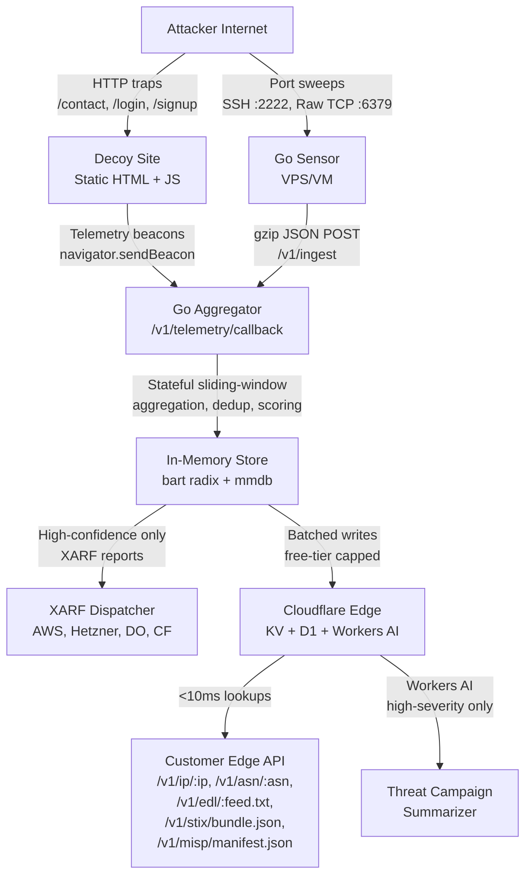

# nullpot

A clean-slate, modular, globally distributed Threat & Abuse Intelligence Platform combining Widenet port reconnaissance traps, high-interaction AI/Compute/Cloud protocol honeypots, and curated OSINT/BGP feeds.

## Architecture



**Data Flow:**

1. **Sensors** (Go, VPS/VM): Widenet all-port listener, HTTP persona traps (Ollama/OpenAI/Docker/env-leak), SSH tarpit, raw TCP traps. Never block on aggregator I/O — telemetry pushed to a buffered channel with drop-oldest overflow.

2. **Decoy Site** (static, GitHub Pages/Netlify/Vercel/Cloudflare Pages): Fake AI/compute provider landing pages with canary tokens, fake login/signup forms capturing credentials, recursive topology traps, and fake OAuth buttons. Every interaction beacons to the aggregator.

3. **Aggregator** (Go): OpenAPI webhook receiver, double-verification correlation (recon + exploit from same IP), C2/IOC extractor, researcher allowlist, TTL decay, risk scoring (0-100), XARF dispatcher, batched Cloudflare sync.

4. **Cloudflare Edge** (Worker + KV + D1 + Workers AI): Sub-10ms IP/ASN reputation lookups, firewall-ready EDLs, STIX/MISP feeds, Workers AI threat-campaign summarizer (invoked only on confirmed high-severity multi-stage attacks).

**Trust Boundaries:** Sensors face the public internet (trap ports). Aggregator is internal processing — should not be directly exposed to attacker traffic. Edge API serves cached reputation data to customers.

## Repository Structure

```
/decoys/ai-compute/     # Static decoy site (GitHub Pages / Netlify / Vercel / Cloudflare Pages)
/edge-api/              # Cloudflare Worker (TypeScript) + KV + D1 + Workers AI
/sensors/               # Go edge sensors (Widenet, HTTP persona, SSH, raw TCP)
/aggregator/            # Go central correlation & risk scoring engine
/specs/                 # OpenAPI 3.1 + OCSF / STIX / MISP / XARF models
/docs/adr/              # Architecture Decision Records (ADR-001 through ADR-015)
/.github/workflows/     # GitHub Actions CI/CD
DEPLOY.md               # Full deployment guide
CHANGELOG.md            # Per-phase changelog
```

## Components

### Static Decoy Site (`decoys/ai-compute/`)
Canary token carrier hosted on GitHub Pages / Netlify / Vercel / Cloudflare Pages. Captures web reconnaissance (scrapers, URL probes, OAuth clicks, form submissions) via obfuscated telemetry beacons. Includes fingerprinting (canvas, WebGL, audio, fonts, connection, device memory), interaction tracking (clicks, mouse, scroll, keyboard, visibility), recursive topology traps, fake OAuth buttons, fake login/signup forms, and a D1-backed contact form.

### Go Edge Sensors (`sensors/`)
Unified single-binary sensor daemon with `TrapModule` plugin interface:
- **Widenet** — all-port TCP/UDP listener using Linux `SO_ORIGINAL_DST`
- **HTTP Persona** — YAML-driven decoy traps (Ollama, OpenAI, Docker, env-leak) with canary token injection
- **SSH** — SSH tarpit capturing commands/droppers (never executed, SHA-256 quarantined)
- **Raw TCP** — stateful banner/payload traps (Redis :6379, Docker :2375)
- **Shipper** — non-blocking buffered gzip JSON batch exporter to aggregator

### Go Aggregator (`aggregator/`)
Central ingestion, correlation, and Cloudflare sync daemon:
- **Ingest** — OpenAPI webhook receiver (gzip JSON POST /v1/ingest)
- **Correlate** — double-verification engine, C2/IOC extractor, researcher allowlist, TTL decay
- **Scoring** — IP prefix table + MaxMind GeoIP/ASN risk scorer (0-100 score)
- **Abuse** — XARF report dispatcher (high-confidence only, never single-packet scans)
- **Cloudflare** — batched KV uploader + D1 writer with free-tier daily caps

### Cloudflare Edge API (`edge-api/`)
Cloudflare Worker serving sub-10ms lookups:
- `GET /v1/ip/:ip` — IP reputation
- `GET /v1/asn/:asn` — ASN reputation
- `GET /v1/edl/:feed.txt` — firewall External Dynamic List
- `GET /v1/stix/bundle.json` — STIX 2.1 bundle
- `GET /v1/misp/manifest.json` — MISP Core Format manifest
- Workers AI scheduled threat-campaign summarizer (high-severity only)

## Observability

### Metrics (Prometheus)
- **Sensor:** `:8090/metrics` — trap events, drops, channel size, uptime, canary tokens, HTTP requests, shipper batches, widenet packets
- **Aggregator:** `:8091/metrics` — ingest events, correlations, risk scores, XARF dispatches, KV/D1 writes, Cloudflare errors, canary callbacks, double-verification
- **Edge API:** standard Cloudflare Workers metrics

### Tracing (OpenTelemetry)
- Distributed tracing via OTLP HTTP exporter — trace context propagated across sensor→aggregator→edge API
- Sampling rate: 10% by default

### Logging
- Structured JSON logging via `log/slog` with contextual fields (module, event_type, src_ip, dst_ip, risk_score, canary_id, payload_sha256)
- Log levels: debug, info, warn, error

### Dashboards (Grafana)
- `observability/grafana/dashboards/nullpot-overview.json` — service status, trap events, risk scores, XARF reports, KV/D1 writes, channel size, canary tokens, double-verification correlations

### Alerting (Prometheus + Alertmanager)
- `observability/alertmanager/rules.yml` — service down, high drop rate, high risk scores, XARF failures, Cloudflare errors, KV/D1 write failures
- `observability/alertmanager/alertmanager.yml` — Slack/email notification routing by severity

## Quick Start

```bash
# Build Go binaries
go build -o sensor ./sensors/cmd/sensor
go build -o aggregator ./aggregator/cmd/aggregator

# Run sensor (requires VPS for arbitrary port binding)
PORT=8080 AGGREGATOR_URL=https://aggregator.example.com/v1/ingest ./sensor

# Run aggregator
PORT=8081 ./aggregator

# Deploy Cloudflare Worker
cd edge-api && wrangler deploy

# Deploy decoy site to Cloudflare Pages (via GitHub Actions CI)
# Or: wrangler pages deploy decoys/ai-compute --project-name=nullpot-decoy
```

## Required CI/CD Secrets

| Secret | Purpose |
|--------|---------|
| `CLOUDFLARE_API_TOKEN` | Cloudflare Pages + wrangler deploy |
| `CLOUDFLARE_ACCOUNT_ID` | Cloudflare Pages + wrangler deploy |
| `CF_WEB_ANALYTICS_TOKEN` | Injected into decoy site HTML |

## Environment Variables

See `DEPLOY.md` for the complete environment variable reference per component.

## Governance

- **ADRs**: `docs/adr/0001-0015` — architecture decisions
- **CHANGELOG**: Per-phase changelog entries
- **CI**: `gofmt`, `go vet`, `go test`, `golangci-lint`, TypeScript typecheck, Cloudflare Pages + Worker deploy

## Legal Guardrails

- Captured payloads are SHA-256 hashed and quarantined — **never executed**
- XARF abuse reports only for high-confidence evidence-backed exploitation (never single-packet port scans)
- Benign researchers (Shodan, Censys, Shadowserver, crawlers) allowlisted and excluded from blocklists/XARF
- Cloudflare free-tier guardrails: no raw firehose, KV < 1,000 writes/day, D1 < 100,000 rows/day, Workers AI only on confirmed high-severity multi-stage attacks
